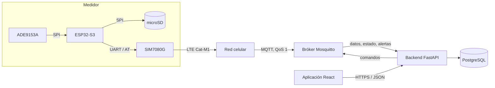

# Medidor de energía IoT

Sistema de medición de energía eléctrica para el sector residencial basado en tecnologías del Internet de las cosas. Incluye el firmware de un medidor monofásico, el bróker MQTT, el backend con su base de datos y una aplicación web para consultar las lecturas, los eventos y el estado de cada medidor.

El medidor usa el circuito de medición ADE9153A y un ESP32-S3, se comunica por LTE Cat-M1 con un módem SIM7080G y guarda cada lectura en una microSD antes de publicarla. Si la red celular falla, las lecturas se envían cuando el enlace vuelve, sin pérdidas ni duplicados en la base de datos.

Este repositorio acompaña el trabajo de grado de la Maestría en Ingeniería del Internet de las Cosas de la Pontificia Universidad Javeriana.

## Características

**Medidor**
- Tensión, corriente, potencia activa, reactiva y aparente, factor de potencia, frecuencia y energía acumulada, con una lectura por minuto.
- Ajuste de ganancia de tensión y autocalibración mSure del ADE9153A.
- Contador de energía en doble precisión que se conserva en memoria no volátil tras un apagado.
- Detección de tensión fuera de la banda de 108 a 132 V (120 V ±10 %) y de pérdida de la red eléctrica.
- Registro local en microSD con identificador de arranque y número de secuencia en cada lectura, y reenvío automático de lo pendiente.
- Recuperación escalonada del enlace celular, desde un reintento de la sesión MQTT hasta el reinicio completo del módem.
- Pantalla OLED, teclado de membrana y reloj de tiempo real.

**Plataforma**
- Bróker Mosquitto con usuario y lista de control de acceso por tópico.
- Backend FastAPI con PostgreSQL que deduplica las lecturas por medidor, arranque y secuencia.
- Aplicación React con tres roles (administrador, operador y visualizador), auditoría de comandos y exportación de lecturas a CSV.
- Histórico con consulta por rango de fechas, alarmas de tensión, estado de conexión y métricas de transmisión de cada medidor.
- Órdenes remotas de sincronización de hora, reinicio, consulta de estado y corte de suministro.

## Arquitectura

La descripción completa está en [docs/arquitectura.md](docs/arquitectura.md).

## Contenido del repositorio

| Carpeta | Contenido |
|---|---|
| [`firmware/`](firmware) | Firmware del medidor (ESP-IDF con PlatformIO) |
| [`backend/`](backend) | API REST, cliente MQTT y modelo de datos (FastAPI, SQLAlchemy) |
| [`frontend/`](frontend) | Aplicación web (React, Vite, Tailwind CSS) |
| [`broker/`](broker) | Configuración de Mosquitto y lista de control de acceso |
| [`hardware/`](hardware) | Esquemático, PCB y lista de materiales |
| [`docs/`](docs) | Arquitectura, despliegue, mensajes MQTT, firmware y plataforma |

## Puesta en marcha

1. Despliegue la plataforma en Railway siguiendo [docs/despliegue-railway.md](docs/despliegue-railway.md): base de datos, bróker, backend y aplicación web.
2. Configure el firmware con los datos de su bróker en `firmware/config/secrets.h` y cárguelo en el medidor ([docs/firmware.md](docs/firmware.md)).
3. Ingrese a la aplicación web, registre el medidor con el identificador que muestra su pantalla y verifique que lleguen las lecturas.

El formato de los mensajes y los tópicos están en [docs/mensajes-mqtt.md](docs/mensajes-mqtt.md), y el uso de la aplicación en [docs/plataforma.md](docs/plataforma.md).

## Limitaciones

El medidor es un prototipo de investigación, no un medidor de facturación. Su exactitud se caracterizó en banco frente a instrumentos de referencia, pero no tiene ensayos de tipo según IEC 62053-21 (NTC 4052) ni certificación según el reglamento metrológico de la SIC. La comunicación usa MQTT con SenML, no DLMS/COSEM. Antes de usarlo con usuarios reales hay que activar TLS, asignar credenciales individuales por medidor e instalar el frente de medida en una tarjeta aislada con envolvente.

## Autor

**Cristian Leonardo Mendivelso Romero**
Maestría en Ingeniería del Internet de las Cosas, Pontificia Universidad Javeriana, Bogotá.

Si usa este trabajo, cítelo con los datos de [CITATION.cff](CITATION.cff).

## Licencia

El código se distribuye con licencia [MIT](LICENSE). La documentación de `docs/` y `hardware/` se distribuye con licencia [CC BY 4.0](https://creativecommons.org/licenses/by/4.0/deed.es).
