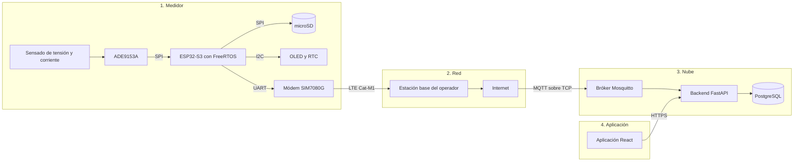

# Arquitectura del sistema

El sistema se organiza en cuatro capas: el medidor, la red de comunicaciones, los servicios en la nube y la aplicación de usuario.

## 1. Medidor

El ADE9153A mide la tensión mediante un divisor resistivo y la corriente mediante una resistencia de derivación, y calcula los valores eficaces, las potencias y la energía. El ESP32-S3 lee esos registros cada segundo, guarda cada lectura en la microSD y la entrega al módem para su publicación. La pantalla y el teclado permiten consultar las variables y el estado de la conexión en sitio. Un UPS con dos celdas 18650 mantiene el medidor encendido durante unas 11 h si falta la red eléctrica.

## 2. Red

El módem SIM7080G se conecta por LTE Cat-M1 a la red de un operador comercial y mantiene una sesión MQTT con su pila interna. No hace falta instalar pasarelas propias. La calidad del enlace depende de la cobertura en el sitio, y el firmware la reporta con los indicadores RSRP, RSRQ, SINR y RSSI en cada mensaje de estado.

## 3. Nube

El bróker recibe los mensajes y los entrega al backend, que valida cada lectura, descarta las repetidas por su identificador, evalúa las alarmas de tensión y guarda todo en PostgreSQL. El mismo backend publica las órdenes hacia los medidores y registra quién las envió.

## 4. Aplicación

La aplicación web consulta la API REST del backend. Muestra el estado de cada medidor, sus variables, el histórico, los eventos y las métricas de transmisión, y permite enviar órdenes según el rol del usuario.

## Trazabilidad de una lectura

Cada lectura nace en el medidor con tres datos que la acompañan hasta la base: el identificador del medidor, un número de arranque y un consecutivo. Con ellos se puede comparar, lectura por lectura, lo que guardó la microSD con lo que llegó a la plataforma, y distinguir una lectura perdida de una retrasada o duplicada. La herramienta `backend/tools/reconcile_obj4.py` hace esa comparación.
